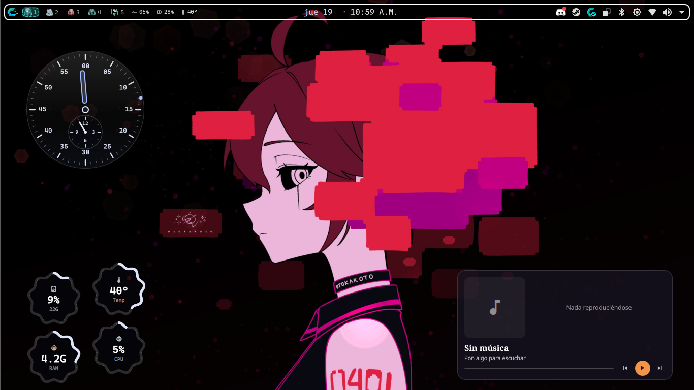
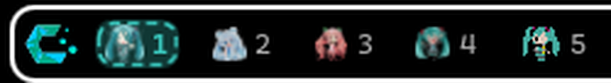

# dotfiles — CachyOS (Arch) + KDE Plasma

Configuración personal de `dns10011`.




## Contenido
| Carpeta | Qué hay |
|---|---|
| `home/` | `.bashrc`, `.zshrc`, `.gitconfig`, `.gtkrc-2.0`… |
| `config/` | fish, alacritty, fastfetch (logo anime), micro, KDE (kwin, kdeglobals, atajos, panel/applets, bloqueo), GTK, servicios systemd de usuario, autostart |
| `local/share/` | Esquema de color *Vidrio*, Konsole, Aurorae, tema Plasma, look-and-feel, plasmoids propios (`com.dns10011.*`, `com.aldx.*`), shell del bloqueo con clima, fondo de pantalla |
| `local/bin/` | `lockscreen-weather-update` |
| `themes/`, `icons/` | Nordic, cursores miku-cursor-linux y Win 10 |
| `sddm-bloqueo/` | Tema de login SDDM a juego con la pantalla de bloqueo |
| `scripts/` | Scripts de SDDM, tema y optimización (`limpieza-pc`) |
| `screenshots/` | Capturas del escritorio |
| `packages/` | Listas de paquetes: `pacman.txt`, `aur.txt`, `flatpak.txt`, `icon-themes.txt` |

## Barra superior con Miku



- **`com.aldx.mikupager`**: escritorios 1–5, cada uno con una Hatsune Miku distinta (clásica, Snow, Sakura, saludando y pixel art). El activo lleva un borde punteado tipo bordado; clic o rueda del ratón para cambiar.
- **`com.aldx.stats`**: CPU · RAM · temperatura.
- La barra es flotante con borde blanco, hecho con [Panel Colorizer](https://github.com/luisbocanegra/plasma-panel-colorizer) (`sudo pacman -S plasma6-applets-panel-colorizer` o desde la tienda de KDE).
- En el escritorio: `com.aldx.dial`, `com.aldx.galletas`, `com.aldx.letras`.

Las imágenes de Miku son fan-art de sus autores (DeviantArt: luana01, KenjiOkumura y Deadsmil3yface; las otras dos vienen de sitios de PNG sin autor indicado). Hatsune Miku © Crypton Future Media.

## Restaurar
```bash
git clone https://github.com/DevAldx/dotfiles.git ~/dotfiles
cd ~/dotfiles
./install.sh --packages   # o ./install.sh solo para las configs
```

Notas:
- Fuente: `CaskaydiaMono Nerd Font` → `sudo pacman -S ttf-cascadia-mono-nerd`.
- Iconos (kora, WhiteSur-purple) no están en el repo por tamaño; ver `packages/icon-themes.txt` (KDE → Descargar nuevos iconos, o AUR).
- No se incluyen tokens, claves ni `fish_variables`.
